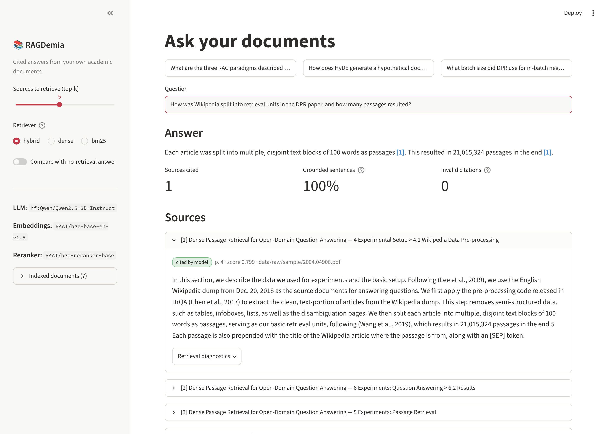
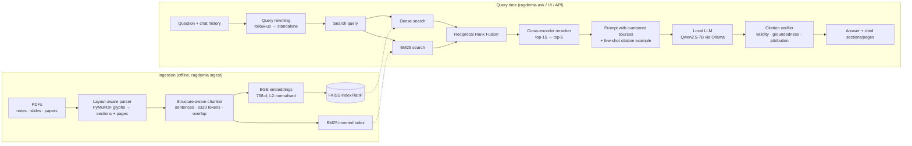

<div align="center">

# 📚 RAGDemia

**Ask questions about your own lecture notes and papers, and get answers that cite the exact section and page.**

Retrieval-augmented generation built from first principles: layout-aware PDF parsing, hybrid dense + BM25 retrieval, cross-encoder reranking, a local open-source LLM, and a verification layer that checks every citation.

[](https://github.com/Shreenitha0408/ragdemia/actions/workflows/ci.yml)




</div>

---

## Live demo

**Live demo: coming soon.** Ask about seven open-access RAG papers, or upload your own PDF; your uploads are private to your browser and deleted after 6 hours. To host your own copy on a free Oracle Cloud server with one command, see [`docs/deployment.md`](docs/deployment.md).

## Why this project

Large language models answer fluently whether or not they know the answer. For academic material (a professor's lecture notes, an unpublished paper, last week's slides) the model *cannot* know the answer, yet it still produces one. RAGDemia fixes that by making the model answer **only from retrieved passages of your own documents**, **cite every claim** down to the section and page, and **say so when the documents don't contain the answer**.

Every stage (PDF layout analysis, chunking, BM25, rank fusion, citation checking, evaluation) is implemented in readable Python rather than hidden behind a framework call. Each module starts with a docstring explaining the method, and [`docs/interview-notes.md`](docs/interview-notes.md) walks through the design decisions.

## Results

Evaluated on a hand-written set of 31 questions over a sample corpus of 7 open-access RAG papers (questions, accepted answer phrasings and gold pages in [`eval/questions.yaml`](eval/questions.yaml)). The **same LLM** answers each question twice, with and without retrieval, so the only variable is grounding. Full report with side-by-side answers: [`eval/results/report.md`](eval/results/report.md).

**Grounding (same LLM, with vs. without retrieval)**

| Metric | LLM alone | RAGDemia | Δ |
|---|---:|---:|---:|
| Key-fact recall, 27 answerable questions | 15% | **75%** | +60 pp |
| Fully correct answers | 7% | **67%** | +59 pp |
| Numeric questions (exact figures from the papers) | 0% | **80%** | +80 pp |
| Correct refusal, 4 unanswerable questions | 50% | **75%** | +25 pp |
| Answers citing a gold document | n/a | **96%** | |
| Answer sentences supported by retrieved text | n/a | **98%** | |

**Retrieval ablation** (gold = right document *and* page, top-5)

| Retriever | Hit@5 | MRR |
|---|---:|---:|
| Dense (BGE + FAISS) | 81% | 0.608 |
| BM25 | 81% | 0.591 |
| Hybrid (RRF) | 81% | 0.575 |
| **Hybrid + cross-encoder rerank** | **96%** | **0.861** |

*LLM for this run: Qwen2.5-3B-Instruct on CPU (Hugging Face backend), greedy decoding. The default laptop setup uses the larger Qwen2.5-7B via Ollama.*

**What the numbers say**

- **Without retrieval, the model invents specifics.** Asked how DPR split Wikipedia, it answered "by sentence"; RAGDemia answered "disjoint 100-word blocks, 21,015,324 passages [1]", with section and page. Asked for Self-RAG's MMLU accuracy (never reported), the plain LLM said "85.3%"; RAGDemia said the documents don't contain it.
- **Reranking is the component that matters most.** Dense, BM25 and their fusion each find the gold page for 81% of questions; the cross-encoder lifts that to 96% and pushes the right chunk to rank 1 much more often (MRR 0.58 → 0.86).
- **Remaining errors are mostly on the generation side.** In 8 of the 9 answerable misses the evidence *was* retrieved. The 3B model either refused too cautiously (3 cases) or read the wrong cell of a results table, e.g. DPR's batch size as 16 (from an ablation table) instead of 128. A larger generator (the 7B default) is the first lever here, not more retrieval work. One error is instructive: asked how many GPUs trained "the Ragas model" (Ragas trains no model), RAGDemia quoted Self-RAG's hardware from a retrieved chunk. This is a *misattribution* across documents, and the next item on the roadmap addresses it.

## Features

- **Layout-aware PDF parsing.** Recovers the section hierarchy (`2 Methods > 2.1 Models`) from font statistics; removes running headers, page numbers, figure labels, rotated sidebars and the bibliography; repairs missing word spaces and hyphenation. Handles both LaTeX papers and Word/PowerPoint-exported course packs, where heading levels are only visible as font sizes and bold table cells must not become headings.
- **Structure-aware chunking.** Chunks are built from whole sentences, never cross a section boundary, overlap by about 64 tokens, and are sized with the embedding model's own tokenizer.
- **Hybrid retrieval.** Dense BGE embeddings (FAISS) and a from-scratch BM25 index, fused with Reciprocal Rank Fusion, then reranked by a cross-encoder.
- **Cited answers.** Each sentence ends with `[n]`, which maps to *document, section, page*.
- **Citation verification.** Flags citations to non-existent sources, scores sentence-level groundedness, and auto-attributes supported sentences the model forgot to cite (labelled as automatic).
- **Honest refusals.** "I couldn't find this in your documents" instead of a guess.
- **Runs fully locally.** An open LLM via Ollama (default) or Hugging Face `transformers`. No API keys and no per-query cost, and documents never leave your machine.
- **Multi-turn chat.** Follow-ups such as "how is it trained?" are rewritten into standalone search queries ("How is byte-pair encoding trained?") using the conversation, and the rewrite is shown to the user.
- **Live document library.** Upload PDFs in the web UI or through `POST /documents`; they are searchable within seconds. Uploaded documents can be removed again, while files you manage on disk are protected.
- **Incremental indexing.** Each file's SHA-256 checksum is stored; re-ingesting only parses and embeds new or changed files, reuses stored vectors for the rest, and drops deleted files. A change to parser, chunking or embedding settings automatically triggers a full rebuild.
- **A web app built for checking answers.** Answers stream in token by token; every `[n]` citation is clickable and opens an **evidence panel** with the exact passage (words used in the answer highlighted), its section breadcrumb, page, and retrieval diagnostics. It also has a document library with drag-and-drop upload, dark mode, and works on a phone. It is plain HTML/CSS/JS served by FastAPI, with no build step.
- **Deployable with live document management.** In public mode, each visitor gets a private, temporary workspace whose uploads are searched alongside the shared library. The admin manages the shared library, which persists to a private Hugging Face dataset. Requests are rate-limited, and any OpenAI-compatible LLM API is supported (Groq for the hosted demo).
- **Three interfaces.** The web app, a CLI (`ragdemia ask`, `ragdemia chat`) and a REST API with Server-Sent-Events streaming.
- **Reproducible evaluation.** Retrieval ablation (Hit@k, MRR), RAG vs. closed-book comparison, abstention tests, and a failure analysis that separates retrieval misses from generation misses.
- **Engineering.** Typed config with environment overrides, an index manifest with checksums and build signature, 41 hermetic tests, CI with ruff, and Docker Compose with NVIDIA GPU support.

## Architecture



### How a question is answered

0. **Condense (follow-ups only).** If there is conversation history, the LLM first rewrites the question into a standalone one ("how is it trained?" → "How is byte-pair encoding trained?"), because a pronoun matches nothing in a search index. The answer is still generated only from freshly retrieved sources.
1. **Retrieve candidates two ways.** The question is embedded with BGE (with BGE's query instruction prefix) and compared against every chunk by cosine similarity. In parallel, BM25 scores chunks by exact term overlap, weighted by term rarity. Dense retrieval understands paraphrase; BM25 catches acronyms, dataset names and numbers, which academic questions are full of.
2. **Fuse.** Reciprocal Rank Fusion, `score(d) = Σ 1/(60 + rank)`, merges the two rankings using ranks rather than incomparable raw scores.
3. **Rerank.** A cross-encoder reads *(question, passage)* pairs jointly and re-orders the top 15. This is slower than a bi-encoder but much more precise, and it raised MRR substantially (see the ablation above).
4. **Generate.** The top 5 passages are numbered `[1]…[5]`, each labelled with its document, section and page. The LLM is instructed to use only these sources, cite every sentence, or reply with a fixed refusal sentence. A one-shot example from an unrelated domain demonstrates the format.
5. **Verify.** Citation numbers are checked against the sources provided. Each answer sentence is matched against the passages to measure lexical support, and uncited but supported sentences are auto-attributed (and labelled as such).

## Tech stack

| Layer | Choice | Why |
|---|---|---|
| PDF parsing | [PyMuPDF](https://pymupdf.readthedocs.io) (`rawdict`) | Per-glyph font, size and position, enough to recover layout without ML |
| Chunking | Custom, sentence-based | Section-bounded chunks give clean citations; sized with the model's tokenizer |
| Embeddings | [`BAAI/bge-base-en-v1.5`](https://huggingface.co/BAAI/bge-base-en-v1.5) via sentence-transformers | Strong retrieval quality for 110M params; free; runs on CPU or GPU |
| Vector index | [FAISS](https://github.com/facebookresearch/faiss) `IndexFlatIP` | Exact search is under 1 ms at this scale; no recall loss, no tuning |
| Lexical search | BM25, implemented from scratch | Exact-term matching; ~60 readable lines |
| Fusion | Reciprocal Rank Fusion (Cormack et al., 2009) | Combines rankings without score normalisation |
| Reranker | [`BAAI/bge-reranker-base`](https://huggingface.co/BAAI/bge-reranker-base) cross-encoder | Large precision gain on the final top-k |
| LLM | [Qwen2.5-7B-Instruct](https://huggingface.co/Qwen/Qwen2.5-7B-Instruct), 4-bit, via [Ollama](https://ollama.com) | Fits about 5 GB of VRAM; good instruction-following; Apache-2.0 |
| LLM (alternative) | Hugging Face `transformers` (`Qwen2.5-3B-Instruct`) | No Ollama needed; used for CI-style and CPU runs |
| Web app | Vanilla HTML/CSS/JS, Server-Sent Events | No build step or framework to explain; streaming over plain HTTP |
| API / CLI | FastAPI, Typer + Rich | Typed request models and auto-generated docs at `/docs` |
| Quality | pytest (hermetic), ruff, GitHub Actions | Tests run without downloading any model |
| Deployment | Docker, Docker Compose (+ NVIDIA GPU override) | One-command local stack |

## Quickstart

> Tested with Python 3.10–3.13. A laptop with 16 GB RAM is enough; an NVIDIA GPU makes it fast (about 5 GB of VRAM for the 7B model).

**1. Install**

```bash
git clone https://github.com/Shreenitha0408/ragdemia.git
cd ragdemia
python -m venv .venv
```

Activate the environment (`.venv\Scripts\activate` on Windows, `source .venv/bin/activate` on macOS/Linux), then:

```bash
pip install -e ".[api,dev]"
```

> **GPU:** if `python -c "import torch; print(torch.cuda.is_available())"` prints `False` on an NVIDIA machine, install the CUDA build of PyTorch from [pytorch.org](https://pytorch.org/get-started/locally/) first.

**2. Install the local LLM**

Install [Ollama](https://ollama.com/download), then:

```bash
ollama pull qwen2.5:7b
```

**3. Add documents and build the index**

```bash
python scripts/download_sample_corpus.py
```

This fetches the 7-paper sample corpus. Put your own PDFs in `data/raw/private/` (git-ignored). Then:

```bash
ragdemia inspect
```

```bash
ragdemia ingest
```

`inspect` audits text extraction, section detection and scanned pages before you index.

**4. Ask**

```bash
ragdemia ask "What are the three RAG paradigms described in the survey?" --compare
```

```bash
ragdemia ui
```

`ragdemia ui` starts the web app at http://localhost:8000 and opens your browser. `--compare` also shows the same LLM's answer without retrieval.

### No Ollama? Use the Hugging Face backend

```bash
RAGDEMIA_LLM__BACKEND=hf ragdemia ask "How does HyDE work?"
```

(PowerShell: `$env:RAGDEMIA_LLM__BACKEND="hf"`.) This loads `Qwen/Qwen2.5-3B-Instruct` in-process.

### Docker (full stack: LLM server + UI + API)

```bash
docker compose up -d --build
```

```bash
docker compose run --rm ingest
```

On an NVIDIA GPU, start the stack with the GPU override instead:

```bash
docker compose -f docker-compose.yml -f docker-compose.gpu.yml up -d --build
```

Web app at http://localhost:8000 · API docs at http://localhost:8000/docs.

## Usage

| Command | What it does |
|---|---|
| `ragdemia inspect [--sections]` | Audit PDFs: pages, characters, detected sections, skipped sections, warnings (scanned pages, slides with little text) |
| `ragdemia ingest [--full]` | Sync the index with `data/raw/`: only new or changed PDFs are parsed and embedded, deleted ones are dropped (`--full` re-processes everything) |
| `ragdemia ask "…" [--compare] [--mode dense\|bm25\|hybrid] [-k 8] [--json]` | One answer with a source table |
| `ragdemia chat` | Multi-turn session; follow-ups are rewritten into standalone queries (`:new` clears the conversation) |
| `ragdemia eval [--questions my.yaml] [--retrieval-only]` | Retrieval ablation and RAG vs. closed-book report → `eval/results/` |
| `ragdemia ui` | Web app at http://localhost:8000 (opens the browser) |
| `ragdemia serve` | Web app + REST API without opening a browser: `GET /health`, `GET /documents`, `POST /documents` (upload), `DELETE /documents/{id}`, `POST /retrieve`, `POST /ask` (with optional `history`), `POST /ask/stream` (Server-Sent Events) |

All settings live in [`config.yaml`](config.yaml) and can be overridden with environment variables, for example `RAGDEMIA_LLM__MODEL=llama3.1:8b` or `RAGDEMIA_RETRIEVAL__TOP_K=8`.

**Example API call**

```bash
curl -X POST localhost:8000/ask -H "content-type: application/json" -d '{"question": "What does Lost in the Middle find?", "compare": true}'
```

## Using your own documents

1. Upload PDFs in the web UI sidebar (they are stored in `data/raw/uploads/` and indexed immediately), **or** copy them into `data/raw/private/` and run `ragdemia ingest`.
2. Run `ragdemia inspect`. Scanned PDFs (no text layer) need OCR first, for example `ocrmypdf in.pdf out.pdf`. Slides exported to PDF work; each slide title becomes a section.
3. Run `ragdemia ingest`.
4. For a credible evaluation of *your* corpus, write 20–40 questions in the format of `eval/questions.yaml` **before** tuning anything, including a few whose answers are *not* in your documents. Then run `ragdemia eval --questions eval/my_questions.yaml`.

## Evaluation methodology

| Metric | Definition | Why |
|---|---|---|
| Hit@5 | A top-5 chunk comes from a gold document **and** gold page | Did retrieval find the evidence? |
| MRR | Mean of 1 / rank of the first gold chunk | Is the evidence ranked high enough to be used? |
| Key-fact recall | Share of required facts (with accepted phrasings) present in the answer | Deterministic correctness, no LLM judge |
| Correct abstention | On unanswerable questions, the system refused | Measures hallucination resistance |
| Citation precision | A cited source belongs to a gold document | Are citations pointing to the right place? |
| Groundedness | Share of answer sentences whose content words are mostly found in one retrieved chunk | Cheap faithfulness proxy (a lower bound: paraphrases score low) |

Design decisions: retrieval and generation are scored separately, so every failure can be attributed to one of them. An LLM-as-judge is avoided because a small local judge is noisy and hard to defend. Both systems share the same model, decoding settings and answer rules.

**Limitations.** The sample papers are public, so the closed-book model may have seen them during pre-training; on private lecture notes the gap is expected to be larger. String matching undercounts correct paraphrases. The test set is small (31 questions), so differences of a few points are not significant.

## Project structure

```
ragdemia/
├── src/ragdemia/
│   ├── parsing.py        # PDF → sections with page-tagged paragraphs (layout heuristics)
│   ├── chunking.py       # sentence splitter, section-bounded overlapping chunks
│   ├── embeddings.py     # BGE bi-encoder (+ hashing embedder for tests)
│   ├── bm25.py           # Okapi BM25 from scratch
│   ├── store.py          # FAISS + BM25 + metadata persistence, manifest
│   ├── retrieval.py      # dense / BM25 / RRF hybrid, cross-encoder reranker
│   ├── prompts.py        # RAG and closed-book prompts, few-shot example
│   ├── llm.py            # Ollama, Hugging Face and stub backends
│   ├── citations.py      # citation parsing, groundedness, auto-attribution
│   ├── pipeline.py       # question → retrieve → generate → verify
│   ├── ingest.py         # incremental indexing (checksums, vector reuse, build signature)
│   ├── library.py        # upload / remove documents at runtime (UI + API)
│   ├── workspaces.py     # private per-visitor indexes for the public demo
│   ├── persistence.py    # admin uploads mirrored to a private HF dataset
│   ├── evaluation.py     # metrics, ablation, Markdown report
│   ├── api.py            # FastAPI app: REST, SSE streaming, serves the web app
│   ├── web/              # web app: index.html, app.css, app.js (no build step)
│   ├── cli.py            # `ragdemia` command
│   └── config.py         # typed config with env overrides
├── eval/questions.yaml   # test set with key facts and gold pages
├── eval/results/         # report.md, summary.json (generated)
├── tests/                # hermetic unit and integration tests
├── scripts/              # sample-corpus downloader
├── deploy/oracle/        # one-command public deployment: install.sh, Compose, Caddy (HTTPS)
├── deploy/huggingface/   # alternative: Hugging Face Space (Docker SDK, needs PRO)
├── docs/                 # design notes, screenshots
├── config.yaml
├── Dockerfile · docker-compose.yml · docker-compose.gpu.yml
└── .github/workflows/ci.yml
```

## Design decisions and trade-offs

- **Heuristic layout analysis instead of an ML layout model.** Transparent and fast. Each rule was added for a failure observed in the real corpus (see the table in [`docs/interview-notes.md`](docs/interview-notes.md)).
- **Exact FAISS search.** Approximate indexes only pay off around a million vectors.
- **Lexical groundedness instead of NLI.** Instant and deterministic. An NLI model is the natural upgrade.
- **Small local model.** Every answer can be checked against its sources, which matters more here than raw fluency. Swapping in a larger model is a one-line config change.

## Roadmap

- [ ] Document-consistency check: flag answers whose cited chunk comes from a different paper than the one the question names
- [ ] NLI-based faithfulness scoring (DeBERTa-v3-MNLI) alongside lexical support
- [x] Multi-turn chat with query rewriting for follow-up questions
- [x] Upload and remove documents from the web UI and API
- [ ] OCR fallback for scanned notes; table extraction
- [ ] Multimodal retrieval over figures and slides with a vision-language model
- [ ] Domain-adapted embeddings fine-tuned on synthetic question–chunk pairs from the corpus
- [x] Incremental ingestion keyed on document checksums

## Acknowledgements

The sample corpus consists of open-access papers by Karpukhin et al. (DPR), Lewis et al. (RAG), Gao et al. (HyDE), Liu et al. (Lost in the Middle), Es et al. (Ragas), Asai et al. (Self-RAG) and Gao et al. (RAG survey). PDFs are downloaded from arXiv at setup and are not redistributed.

## License

MIT. See [LICENSE](LICENSE).
